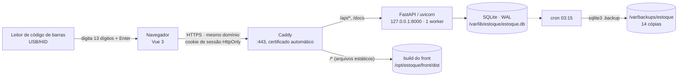

# Arquitetura

Sistema de gestão e rastreabilidade de doações da **Casa São José**: voluntários bipam as
embalagens com um leitor óptico USB (HID) na bancada de triagem; cada leitura vira uma
movimentação imutável; o voluntário chefe acompanha os indicadores no dashboard.

## Visão geral



Uma única instância EC2 `t3.micro` em `sa-east-1` (São Paulo) hospeda tudo. Em
desenvolvimento ou no plano B (`run_local.sh`), o próprio FastAPI serve o build do front
(`ESTOQUE_FRONT_DIST`) e o Caddy não é necessário.

## Stack

| Camada | Tecnologia | Por quê |
| --- | --- | --- |
| Front | Vue 3 + Vite + TypeScript, vue-router, Chart.js | Leve, sem framework de UI; build estático servido pelo Caddy |
| Tipografia | Montserrat empacotada (`@fontsource/montserrat`) | Sem CDN: funciona offline e não depende de terceiros |
| API | FastAPI + Pydantic 2 | Validação declarativa (422 legível), Swagger automático em `/docs` |
| ORM / migrações | SQLAlchemy 2.0 + Alembic | Migrações versionadas aplicadas sozinhas ao subir |
| Banco | SQLite (WAL, `foreign_keys=ON`, `busy_timeout`) | Zero administração; volume da Casa cabe com folga |
| Senhas | `bcrypt` direto | `passlib` está abandonado e quebra com `bcrypt>=4.1` |
| Sessão | `SessionMiddleware` (cookie assinado com `itsdangerous`) | Sem token no navegador, sem CORS |
| Proxy / TLS | Caddy | HTTPS automático (Let's Encrypt/ZeroSSL), config de 30 linhas |
| Dependências | `uv` (dev) · `requirements.lock` com hashes (produção) | O que roda na EC2 é byte a byte o que foi testado |
| Testes | pytest (API) · Playwright (ponta a ponta, simulando o leitor) | — |

## Decisões de projeto e justificativas

| Decisão | Justificativa | Implicação |
| --- | --- | --- |
| **SQLite no disco da EC2** (D2) | Sem custo de RDS; um escritor por vez basta para 1–3 bancadas | **Nunca "Terminate"** a instância (o disco é apagado). Backup local protege contra erro lógico, não contra perda do volume |
| **Um worker do uvicorn** | O SQLite aceita um escritor por vez; com um processo não há disputa de lock | Escala vertical apenas; suficiente para o volume da Casa |
| **Movimentação imutável (livro-razão)** | Rastreabilidade: o histórico nunca é reescrito; saldo = `SUM(quantidade)` | Correção = novo AJUSTE com motivo obrigatório |
| **Sinal na quantidade** (SAÍDA < 0) | Saldo sem `CASE`; `CHECK` no banco garante a coerência por tipo | — |
| **Exclusão lógica** (`deleted_at`) | Preserva o histórico; o código de barras volta a ficar livre | Índices únicos **parciais** (`WHERE deleted_at IS NULL`) |
| **Conteúdo da embalagem + unidade com fator** (D4/D5) | O estoque conta embalagens; o dashboard converte para kg/L/un | Unidade em uso não muda grandeza nem fator (alteraria totais passados) |
| **Cookie de sessão assinado, mesmo domínio** (D6) | `HttpOnly` (JS não lê), `SameSite=Lax` (barra CSRF entre sites), `Secure` em produção | Front e API precisam estar no mesmo domínio |
| **Sessão com versão** (`usuario.sessao_versao`) | Desativar, trocar senha ou perfil derruba as sessões abertas na requisição seguinte | Uma leitura de `usuario` por requisição (barata no SQLite) |
| **Permissão conferida no backend, por router** | RNF05: URL direta não fura o perfil; o front só esconde o que o perfil não usa | Matriz testada em `tests/test_auth.py` |
| **sslip.io + Elastic IP** (D13) | HTTPS sem comprar domínio; o IP fixo mantém endereço e certificado | Domínio próprio: uma linha em `/etc/estoque/dominio` |
| **Front buildado fora da EC2** | A `t3.micro` (1 GB) não precisa de Node | Branch `deploy` do front guarda o `dist/` pronto |

## Organização do código (backend)

Uma pasta por funcionalidade, todas com as mesmas camadas
(`controller` → `service` → `repository` → `domain/entity`):

```
src/estoque_doacoes/
├── main.py              # app, middleware de sessão, routers, SPA opcional
├── migrar.py            # aplica migrações ao subir
├── seed.py              # dados iniciais idempotentes (unidades, categorias)
├── entidades.py         # importa todas as entidades (scripts e Alembic)
├── migrations/          # Alembic (3 revisões)
├── scripts/             # criar_admin (bootstrap), seed
├── shared/              # banco, erros de domínio → HTTP, validações comuns
├── auth/                # login/logout/me, usuario_atual, require_role, bcrypt
├── usuario/             # gestão de usuários (ADMIN)
├── categoria/  unidade/  produto/  movimentacao/  dashboard/
```

Erros: o service lança erros de **domínio** (`NaoEncontrado`, `Conflito`, `DadosInvalidos`,
`NaoAutenticado`, `SemPermissao`); o `GlobalExceptionHandler` traduz para 404/409/422/401/403
no formato único `ErroResposta` (`mensagem` + `campos`).

## Organização do código (front)

```
src/
├── config/        # env, api-routes (ÚNICO lugar com caminhos HTTP), http (401 → login)
├── services/      # uma função por rota
├── composables/   # useAuth, useCategorias, useUnidades, useToast
├── router/        # rotas com meta.perfis; guarda de login e de perfil
├── views/         # Login · operacao/ · admin/ · dashboard/
└── components/    # ProdutoForm, KpiCard, SaldoBadge, TipoBadge, ToastContainer
```
