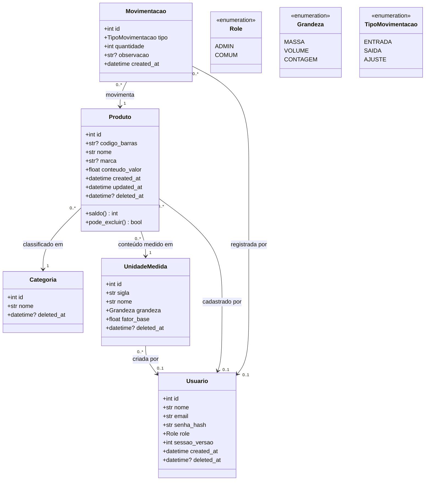
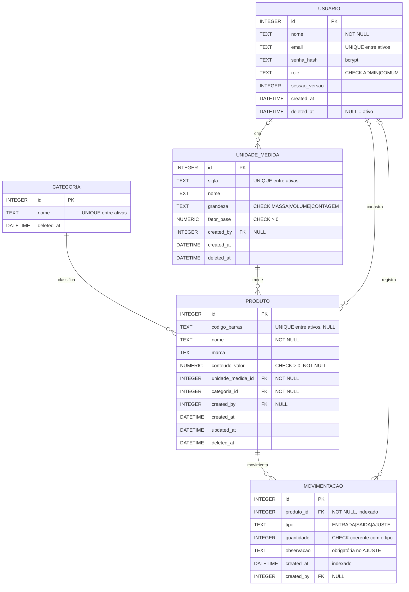

# Modelo de dados

Banco SQLite criado e evoluído **somente por migrações** do Alembic (aplicadas ao subir a API
ou por `python -m estoque_doacoes.scripts.seed`). Datas gravadas em **UTC**; o front exibe em
`America/Sao_Paulo`.

## Entidades

| Entidade | Papel | Regras principais |
| --- | --- | --- |
| **Usuario** | Quem entra no sistema | `email` único entre ativos (minúsculo); `senha_hash` bcrypt; `role` ADMIN ou COMUM; exclusão lógica; `sessao_versao` invalida sessões |
| **Categoria** | Agrupa produtos (filtro do dashboard) | Nome único entre ativas; não exclui com produto ativo; seed: Alimentos, Bebidas, Higiene, Limpeza, Vestuário, Outros |
| **UnidadeMedida** | Unidade do conteúdo de uma embalagem | `grandeza` MASSA/VOLUME/CONTAGEM; `fator_base > 0` converte para kg/L/un; sigla única entre ativas; **em uso: só o nome muda, não exclui** |
| **Produto** | Item do catálogo (um SKU) | Código de barras único entre ativos (8–14 dígitos, opcional no banco); `conteudo_valor > 0` obrigatório; exclusão lógica só com saldo zero; reativação pelo ADMIN |
| **Movimentacao** | Livro-razão imutável | ENTRADA > 0, SAÍDA < 0, AJUSTE ≠ 0 **com motivo**; sem UPDATE/DELETE; `created_by` registra o autor |

**Conteúdo × quantidade.** `produto.conteudo_valor` + `unidade_medida` descrevem **o que há
dentro de uma embalagem** (pacote de arroz = 5 kg). `movimentacao.quantidade` conta
**embalagens**. Peso total de um produto = saldo × `conteudo_valor` × `fator_base`.

**Saldo** não é coluna: `SUM(movimentacao.quantidade)` por produto. Pode ficar negativo
(saída registrada antes da entrada): o sistema avisa sem bloquear e lista em "Pendências".

## Diagrama de classes



## Diagrama ER



`created_by` é nullable apenas por compatibilidade com registros anteriores ao login; toda
gravação feita pela API preenche o autor.

## Regras garantidas no banco (não só na API)

- `CHECK (conteudo_valor > 0)` em `produto`; `CHECK (fator_base > 0)` em `unidade_medida`.
- `CHECK` de movimentação: `ENTRADA > 0`, `SAIDA < 0`, `AJUSTE ≠ 0 AND trim(observacao) <> ''`.
- Índices únicos parciais: código de barras, nome de categoria, sigla de unidade e e-mail
  — todos só entre registros ativos.
- `PRAGMA foreign_keys=ON` em toda conexão.

## Seed de unidades

| Sigla | Nome | Grandeza | Fator base |
| :-: | --- | :-: | :-: |
| kg | quilograma | MASSA | 1 |
| g | grama | MASSA | 0,001 |
| L | litro | VOLUME | 1 |
| mL | mililitro | VOLUME | 0,001 |
| un | unidade | CONTAGEM | 1 |
| dz | dúzia | CONTAGEM | 12 |

## Consultas de referência

```sql
-- Saldo (embalagens) de cada produto ativo
SELECT p.id, p.nome, COALESCE(SUM(m.quantidade), 0) AS saldo
FROM produto p LEFT JOIN movimentacao m ON m.produto_id = p.id
WHERE p.deleted_at IS NULL GROUP BY p.id;

-- Estoque em kg (MASSA)
SELECT SUM(m.quantidade * p.conteudo_valor * u.fator_base)
FROM movimentacao m
JOIN produto p ON p.id = m.produto_id
JOIN unidade_medida u ON u.id = p.unidade_medida_id
WHERE p.deleted_at IS NULL AND u.grandeza = 'MASSA';

-- Pendências: saldo negativo
SELECT p.id, p.nome, SUM(m.quantidade) AS saldo
FROM produto p JOIN movimentacao m ON m.produto_id = p.id
WHERE p.deleted_at IS NULL GROUP BY p.id HAVING saldo < 0;
```
